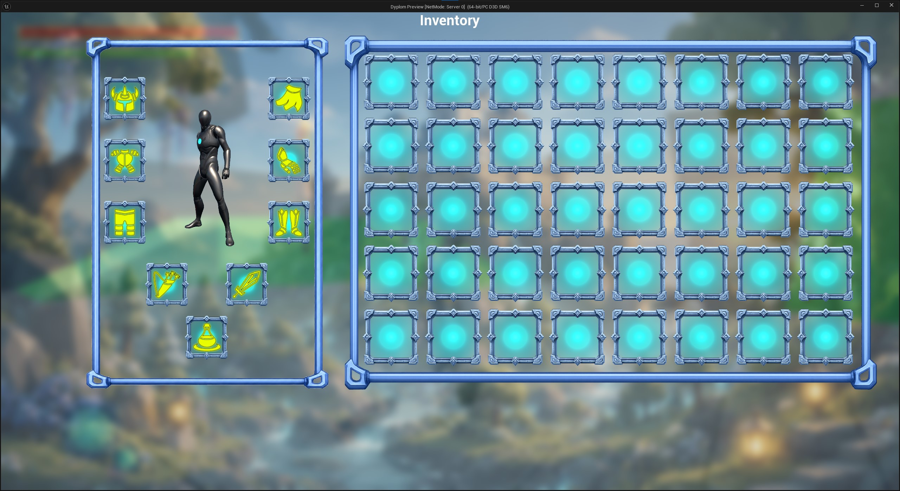
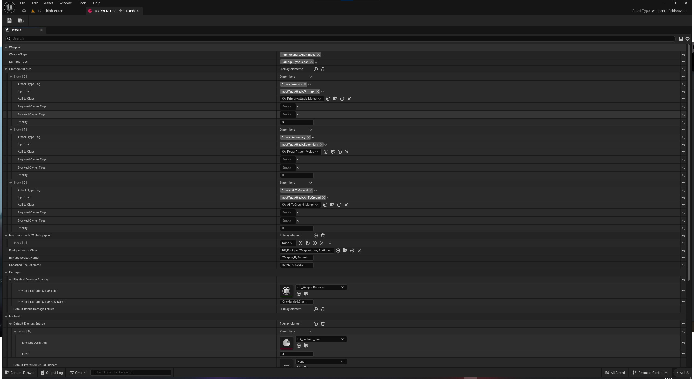

# Engineering Thesis - Action RPG Dungeon Crawler Demo

A complete playable Unreal Engine 5 demo focused on gameplay programming: a
GAS-driven combat model connected to equipment, progression, data-driven loot,
enemy AI, a multi-stage dragon encounter, and persistent repeatable runs.

[Watch the video showcase](#video-showcase) ·
[Browse selected C++ samples](CodeSamples/README.md) ·
[Open the complete portfolio playlist](https://www.youtube.com/playlist?list=PLxXKv2ZyiFaTjrA4zKqaofoGy1IaJdq8e)

| | |
|---|---|
| **Role** | Solo Gameplay Programmer |
| **Technology** | Unreal Engine 5, C++, Blueprints, Gameplay Ability System, UMG |
| **Primary focus** | Combat, inventory and equipment, loot, AI, progression, persistence |
| **Project state** | Complete playable single-player demo |
| **Version control** | Diversion, selected excerpts published in this repository |

## Project Overview

This engineering thesis is an action RPG dungeon crawler designed around short,
self-contained play sessions. The player explores the map, fights enemies,
collects equipment and consumables, improves core attributes, and prepares for
a multi-stage dragon boss. Defeating the boss unlocks another run on a fresh
map while preserving the character's progression and equipment.

The central design goal was to make equipment choice matter. Enemy levels scale
with the player, so outdated gear gradually falls behind. Damage types,
resistances, weaknesses, status effects, and enchantments create trade-offs
between higher raw statistics and items that better counter the current
encounter.

The project was developed solo. Visual, animation, audio, and environment assets
are third-party resources; my work focuses on gameplay architecture,
implementation, integration, UI logic, encounter design, and debugging.

## Core Gameplay Loop

1. Explore the dungeon and defeat enemies to earn experience.
2. Open chests and collect enemy drops, equipment, accessories, and consumables.
3. Compare item level, rarity, damage or armor, resistances, and enchantments.
4. Spend level-up points on Health, Mana, or Stamina.
5. Adapt the loadout to enemy resistances and weaknesses.
6. Defeat the dragon and enter the portal to start a higher-level run while
   retaining character progression.

This loop is intentionally suitable for a brief session rather than requiring
the player to follow a long narrative campaign.

## Video Showcase

| Video | Demonstrated systems |
|---|---|
| [Inventory, Equipment & Random Loot System - Update 1](https://www.youtube.com/watch?v=eB6E8bYDTqU) | Pickups, normal and extended tooltips, drag and drop, equipping, potions, stack splitting, and chest loot |
| [Movement & Melee Combat Abilities - Update 2](https://www.youtube.com/watch?v=CsP9E8AFDZU) | Turn in place, sprint, roll, jump, double jump, combo, air-to-ground attack, and power attack |
| [Combat Damage & Hit Reactions - Update 3](https://www.youtube.com/watch?v=3aogIlNINv4) | Damage against a target dummy, multiple combo steps, sprint attack, power attack, air-to-ground attack, and light, medium, and knockdown reactions |

The [portfolio playlist](https://www.youtube.com/playlist?list=PLxXKv2ZyiFaTjrA4zKqaofoGy1IaJdq8e)
also contains demonstrations of my earlier Unreal Engine projects.

## Player Combat and Movement

The current demo uses a one-handed melee moveset. Attacks are implemented as
Gameplay Abilities and are driven by animation events, configurable attack
profiles, weapon traces, and Motion Warping.

### Combat Abilities

- A multi-step primary combo with explicit input and transition windows.
- A separate sprint attack selected from the current movement state.
- A charged power attack with start, loop, and release stages, a minimum charge
  requirement, charge scaling, and UI feedback.
- An air-to-ground attack whose result depends on the descent and landing.
- Executions for eligible low-health enemies. The system reserves the target,
  selects a compatible weighted attacker/victim montage pair, aligns both
  actors, protects the execution state, and finishes with ragdoll and local
  camera feedback.

### Movement

- Turn in place, sprint, jump, and double jump.
- Standard roll, roll-to-run, and sprint-roll-to-run variants.
- Animation-timed invulnerability frames during evasive actions.
- Stamina drain while sprinting only when the character is moving.
- Root-motion scaling and Motion Warping for attack positioning.

### Hit Detection and Reactions

Weapon collision uses swept traces between the previous and current positions
of configured weapon sockets. A target can only be damaged once during a trace
window. Each window can select its own damage and hit-reaction profile, allowing
individual combo steps to produce light, medium, knockdown, or other reactions.

Animation notifies and notify states open combo windows, enable damage traces,
trigger area damage, control invulnerability, and synchronize executions. This
keeps attack timing aligned with the animation while the authoritative gameplay
logic remains in C++ and GAS.

## GAS-Driven Equipment

The inventory, equipment, and Gameplay Ability System are connected through
stable item instances:

- Equipping a weapon grants the abilities and passive Gameplay Effects
  configured for that item.
- Granted ability and effect handles are stored per item instance and removed
  when the exact item is unequipped.
- Armor, weapon, accessory, and enchantment effects use Gameplay Tags and
  scalable Gameplay Effect values.
- Damage is resolved through a custom Execution Calculation that maps damage
  components to their matching resistance attributes before adding the result
  to an `IncomingDamage` meta attribute.
- Periodic and status damage is marked so it cannot recursively trigger weapon
  procs.

## Inventory, Equipment, and Quick Wheel

The player's storage is split into a backpack and equipped items. Inventory
operations support pickups, stacking, drag and drop, double-click equipping,
stack splitting, tooltips, direct item use, and dropping items back into the
world.

### Equipment

- One weapon slot and modular armor slots for the head, chest, gloves, legs,
  and boots.
- One combat consumable slot for immediate access to a potion.
- Two ring slots and one necklace slot. Accessories are obtainable and visible
  when equipped; the current demo does not assign additional combat effects to
  them.
- Weapons and armor use open-ended item levels intended to follow the player's
  natural progression.
- Item rarity increases base damage or armor and influences enchantment quality
  and count.

Weapons currently use one-handed animations but can deal four physical damage
types: Slash, Pierce, Blunt, and Chop. Armor is divided into Light, Medium, and
Heavy sets, each with different armor values and physical or magical resistance
profiles, including possible weaknesses.

### Consumables

Consumables use their own five-level progression rather than inheriting the
player's level. Their effect is also modified by a potency tier: Small, Medium,
Large, or Ultimate.

Supported categories include:

- **Instant Restore** - immediately restores a vital resource.
- **Buff** - temporarily increases an attribute or resistance.
- **Regeneration** - improves ongoing Health, Mana, or Stamina regeneration.
- **Cure** - removes a corresponding physical status effect and cannot be
  consumed when that status is absent.

### Favorites Quick Wheel

The radial favorites menu exposes up to eight items during combat. It can use
potions or rapidly equip a weapon when a different damage type is needed.

Stackable consumables are referenced by item ID and rarity, so the favorite can
resolve another matching stack after the original one is consumed. Unique gear
uses its instance GUID. The client requests an activation, while the server
resolves the current item location and performs the actual inventory or
equipment operation.

## Damage Types, Resistances, and Physical Statuses

Every damage component is evaluated against its matching resistance. Negative
resistance acts as a weakness. Physical weapons additionally have a chance to
apply a status associated with their damage type; the target's corresponding
physical resistance or weakness also modifies that proc chance.

| Weapon damage | Status | Effect |
|---|---|---|
| **Slash** | Bleed | Stackable damage over time, up to three active stacks |
| **Chop** | Mortal Wound | Temporarily raises the target's death threshold above zero Health; the strongest active threshold wins and is represented on the health bar |
| **Blunt** | Bone Break | Reduces the target's outgoing physical attack damage |
| **Pierce** | Puncture | Reduces the target's physical resistances |

Each physical status has a dedicated Cure consumable. Status and periodic damage
cannot trigger another status proc, preventing recursive damage chains.

## Enchantment System

Weapon and armor enchantments have ten strength levels. Definitions are
data-driven and use the same configurable effect pipeline rather than requiring
a separate ability class for every item variant.

<strong>Weapon enchantments</strong>

| Enchantment | Behaviour |
|---|---|
| **Fire** | Applies one refreshable Burn per attacker. It ticks once per second for four seconds, checks Fire Resistance on every tick, and does not critically hit or trigger a hit reaction. |
| **Frost** | Adds a five-second Chill stack and refreshes the stack duration. Four stacks are consumed by Frostbite, which deals additional Frost damage and applies a strong short slow. A boss may resist the control effect while still taking the damage. |
| **Lightning** | Chains from the struck target to as many as three nearby enemies. A target cannot be selected twice and each jump can deal less damage than the previous one. |
| **Poison** | Applies a six-second, stackable damage-over-time effect. Up to four stacks increase periodic damage, reapplication refreshes the duration, and every tick checks Poison Resistance. |
| **Corruption** | Builds up to three stacks that reduce all physical and magical resistances. Direct Corruption damage still checks Corruption Resistance. |
| **Wind** | Deals direct Wind damage and applies Pressure. Reaching the configured threshold consumes the stacks and triggers Gust, staggering or pushing the target. |
| **Water** | Deals direct Water damage and applies Soaked. Soaked lowers Lightning and Frost resistance while increasing Fire resistance, preparing elemental combinations. |

Armor can roll standard Fire, Frost, Corruption, Lightning, Water, or Wind
resistance enchantments. Poison is handled separately and is intentionally not
part of this standard resistance group.

<strong>Special armor enchantments</strong>

| Enchantment | Charge source and result |
|---|---|
| **Aqua Veil** | Magical damage taken builds charge; activation temporarily increases all magical resistances. |
| **Arcane Ward** | Damage taken builds charge and creates a protective barrier. |
| **Aura of Fury** | Damage dealt builds charge and temporarily increases Physical and Magical Power. |
| **Flame Retribution** | Damage taken builds charge and creates a burning damage aura. |
| **Ironheart** | Incoming hits build charge and temporarily increase physical resistances. |
| **Last Light** | Prevents an otherwise fatal hit, restores a portion of maximum Health, and enters cooldown. |
| **Magma Shell** | A hit received at low Health can trigger radial Fire damage and Burn. |
| **Nature's Renewal** | Damage received at low Health can start a regeneration effect. |
| **Storm Retribution** | Direct hits build charge; activation sends chain lightning back toward the attacker. |
| **Vengeful Aegis** | Kills build charge and activate a damage-reflection shield. |
| **Venom Shroud** | Damage dealt builds charge and activates a Poison aura. |

## Data-Driven Loot and Chests

Chest loot uses assisted randomness based on a shared category bag. A loot
profile defines a finite number of category tokens such as weapons, armor,
consumables, and accessories. Every chest using the same `LootTableID` draws
from the same runtime bag; a category token is removed after a successful roll,
and the bag is refilled only when exhausted.

This prevents long unlucky streaks while preserving variation. A roll resolves
in stages:

1. Draw an eligible category from the remaining bag tokens.
2. Select a compatible rarity from the chest profile's weighted configuration.
3. Select a concrete item from the category using entry weights and level
   restrictions.
4. Generate quantity and item level.
5. Roll enchantment count and strength according to the rarity.
6. Create a unique item instance.

Equipment from a chest is generated close to the player's current level.
Consumables retain their independent level range. Rusty and Small chests favor
weaker rewards, Iron chests provide a balanced middle tier, and Gold chests use
the strongest rarity distribution and better access to equipment categories.

Chest generation and storage are server-authoritative. Contents are generated
when the chest is opened, replicated to viewers, and persisted. The player can
take a selected item, take all items, or leave the remaining contents behind.
Enemy drops use the same item model but may produce no item, whereas a configured
chest always generates its reward count.

Dropping an inventory item creates a pickup actor that preserves the item's
instance data. Chest items are transferred directly into the player's inventory
instead of spawning an intermediate world pickup.

## Progression

The replicated Player State owns character level, current experience, unspent
attribute points, and the player's Health, Mana, and Stamina investments.

- Enemies award level-scaled experience; summoned minions can be configured not
  to grant XP.
- One attribute point is awarded for every level gained, including multiple
  levels from one XP reward.
- Each point can be invested in Health, Mana, or Stamina.
- Enemy spawn levels are selected around the current player level.
- Loot source level is derived from the player, keeping equipment progression
  relevant across repeated runs.

Player level increases only through earned experience. Entering the end portal
does not grant a free level.

## Enemy AI

### Enemy Roster

| Enemy | Combat role |
|---|---|
| **Knight** | The basic melee archetype, designed to remain readable when several enemies fight together. |
| **Archer** | A ranged skirmisher that retreats from the player and deals moderate direct damage from a distance. |
| **Mage** | A mini-boss-style caster with powerful ranged attacks, summons, area denial, and a close-range knockdown used to create distance. |
| **Summoned Minion** | An aggressive melee disruptor that never spawns naturally and is created by the Mage or Dragon. |

The Mage can use:

- **Corrupted Projectile** - a direct ranged Corruption attack.
- **Ground Spline** - a hammer strike creates a persistent path that damages the
  player while they stand on it.
- **Lightning Storm** - multiple high-damage lightning strikes, each resolving
  independently over an area.
- **Summon** - creates minions that pressure the player while the Mage prepares
  heavier attacks.
- **Close-range Knockdown** - interrupts a nearby player and creates space for
  the Mage to resume ranged combat.

### Shared AI Architecture

Enemies combine State Trees, GAS abilities, and AI Perception for sight,
hearing, and damage stimuli. Shared controller logic tracks the combat target
and last known location, manages investigation and return-home behaviour,
alerts nearby allies, coordinates limited melee attack slots, and supports
interrupting abilities when the encounter state changes.

### Wave Arenas

Selected areas use a reusable wave-arena actor. Each wave defines enemy classes,
counts, spawn intervals, and delays. Spawn points are weighted, can enforce a
minimum distance from the player, and avoid repeatedly selecting the same point.

The encounter snapshots its level when it begins and applies it consistently to
all spawned enemies. It can deactivate configured doors or actors at the start
and reactivate them after completion. Player death resets the active encounter;
a completed arena is recorded in the save and remains completed after loading.

## Dragon Boss Encounter

The dragon is a server-controlled multi-stage encounter rather than a single AI
health pool. Its primary flow is:

`Phase 1 Ground -> Phase 1 Aerial -> Phase 2 Ground -> Phase 2 Aerial -> Phase 3 Mixed`

During ground stages the player can damage the boss. The first two aerial stages
are survival and add-control intermissions: the dragon lands only after the
minimum air time, required attacks, summon waves, living minions, and active
hazards all satisfy the phase configuration. Phase 3 does not have a mandatory
aerial intermission; it can start short probability-driven air sequences with a
maximum number of consecutive actions.

| Attack | Availability |
|---|---|
| **Bite** | Ground, Phases 1-3 |
| **Claw** | Ground, Phases 1-3 |
| **Fireball** | Phase 1 |
| **Explosive Fireball** | Phases 2-3 |
| **Fire Spread** | Phases 2-3; breathes fire around the dragon |
| **Barrage** | Phase 1; scatters multiple fireballs |
| **Explosive Barrage** | Phases 2-3 |
| **Summon** | Aerial only, Phases 1-3 |
| **Flyover** | Aerial only, Phases 1-3; crosses the arena while breathing fire |
| **Bite and Throw** | Ground, Phases 2-3; grabs the player and throws them in ragdoll |
| **Meteor Rain** | Phase 2 aerial stage after the summoned minions are defeated |

During ground combat in Phases 1 and 2, sustained close pressure can trigger a
tactical relocation. After a randomized pressure duration the dragon selects a
valid arena point farther from the player, takes off, relocates, and lands with
a cooldown before the behaviour can repeat. Phase 3 uses its mixed aerial
sequence instead.

If the player dies or leaves the arena, the encounter cancels active abilities,
removes encounter-owned minions and hazards without awarding loot, returns the
dragon home, restores its Health, and resets it to Phase 1. Defeating the dragon
activates the exit portal.

## Persistent Saves and Repeatable Runs

A Game Instance subsystem manages manual saves, rotating quick-save slots, an
auto-save, a lightweight save index, and the transition into another run. Saving
is disabled while the player is dead or actively in combat.

Player persistence includes:

- Level, XP, unspent points, attribute investments, and completed run count.
- Inventory item instances, equipped items, and quick-wheel favorites.
- Appearance, character transform, camera rotation, and current vital values.

World persistence uses stable authored IDs and records:

- Completed wave arenas and cleared enemy spawn points.
- Whether chest loot was generated and which items remain inside.
- Door state, locks, opening direction, and switch state.
- Dropped pickups with class, item data, and transform.
- Activated exit portals.

Temporary Gameplay Effects are intentionally not serialized. Effects granted by
equipment are reconstructed when the saved equipment is restored.

A normal load restores the saved world, player transform, and current vitals.
Starting a new run preserves progression, inventory, equipment, appearance, and
favorites, but loads a fresh world at the Player Start with full vital resources.
Enemy and loot scaling then follow the retained player level.

## Player-Facing UI

C++ Widget Controllers expose gameplay state to Blueprint UMG presentation.
The project includes:

- A main menu for new game, continue, load, overwrite, delete, settings, and
  quit actions.
- Save metadata and thumbnails, including character name, level, run count,
  playtime, map, appearance, and equipped visuals.
- Character creation with name validation, gender and appearance options,
  randomization, and a dedicated display actor and camera.
- Modular armor visuals that can replace or hide character body parts while
  preserving the saved appearance configuration.
- Video, quality, resolution scale, motion blur, audio category, mouse, and
  gamepad settings with staged apply, defaults, and timed reversion of
  unconfirmed display changes.

## Multiplayer-Oriented Architecture

The delivered demo is single-player and does not include sessions, matchmaking,
or a dedicated-server build. However, most gameplay systems were structured
around Unreal's client-server model:

- Inventory, equipment, quick-wheel activation, chest transfers, pickups, loot
  generation, AI, and boss encounter state are server-authoritative.
- Replicated state, RPC validation, GAS effects, and Fast Array delta
  replication are used where appropriate.
- UI requests gameplay actions; it does not directly mutate authoritative
  inventory or combat state.

This is not presented as finished multiplayer support. Motion-warped attacks and
sprinting can still cause visible client corrections and jitter and would need
additional prediction, synchronization work, and multi-client testing before a
multiplayer release.

## Selected C++ Samples

The samples are lightly trimmed from the project to remove unrelated boilerplate
and include additional English comments for portfolio readability.

| Area | Sample | Focus |
|---|---|---|
| Damage | [`DamageExecution.cpp`](CodeSamples/DamageExecution.cpp) | Damage-type-to-resistance mapping in a custom GAS Execution Calculation |
| Equipment | [`EquipmentAbilityLifecycle.cpp`](CodeSamples/EquipmentAbilityLifecycle.cpp) | Granting and safely removing abilities and effects per equipped item instance |
| Replication | [`ReplicatedInventoryFastArray.h`](CodeSamples/ReplicatedInventoryFastArray.h) | Fast Array inventory entries and delta replication callbacks |
| Authority | [`ServerAuthoritativeStackTransfer.cpp`](CodeSamples/ServerAuthoritativeStackTransfer.cpp) | Validated stack transfers and dirty-entry marking |
| Quick wheel | [`QuickWheelFavorites.cpp`](CodeSamples/QuickWheelFavorites.cpp) | Stable references for stackable consumables and unique equipment |
| Enchantments | [`WeaponEnchantmentProcs.cpp`](CodeSamples/WeaponEnchantmentProcs.cpp) | One configurable pipeline for DoTs, buildup, chains, effects, and UI tracking |
| Loot | [`LootBagGeneration.cpp`](CodeSamples/LootBagGeneration.cpp) | Shared category bags and hierarchical server-side item generation |
| Boss | [`DragonBossEncounter.cpp`](CodeSamples/DragonBossEncounter.cpp) | Health phases, aerial objectives, mixed Phase 3, and encounter reset |
| Persistence | [`SaveAndNewRun.cpp`](CodeSamples/SaveAndNewRun.cpp) | Player carry-over, fresh-world runs, and stable-ID world state |

[Read the code sample guide](CodeSamples/README.md)

## What This Project Demonstrates

- Designing connected gameplay systems instead of isolated mechanics.
- Practical use of C++, Blueprints, GAS, Gameplay Tags, Data Assets, Data Tables,
  UMG, State Trees, AI Perception, Niagara, and animation-driven events.
- Data-driven content that lets items, loot profiles, attacks, reactions,
  enchantments, enemies, and encounter requirements be configured without
  duplicating gameplay code.
- Server-authoritative boundaries and replication-aware data structures even in
  a single-player deliverable.
- Persistence across complex player and world state, including a deliberate
  distinction between loading a save and starting a new run.
- Scoping a large solo Unreal Engine project into a complete playable demo.

## Source Availability

The full Unreal Engine project is maintained in
[Diversion](https://www.diversion.dev/) because it contains large binary assets.
This GitHub repository contains the case study, screenshots, videos, and curated
C++ excerpts most relevant to gameplay programming review.
